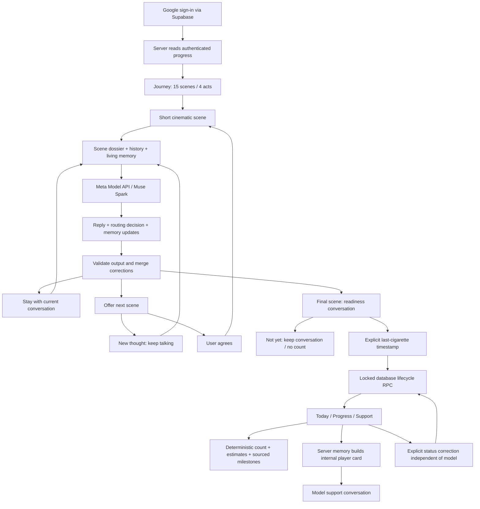

# Architecture for the demo

Use this to explain the implemented flow, not to claim that production reliability or quitting effectiveness has been proven.

## Evidence to show, in order

1. A film followed by a real personal answer and model response.
2. A correction carried forward rather than a fixed questionnaire branch.
3. A transition offer declined to keep talking, followed by consensual progression.
4. Not yet versus explicit timestamp confirmation.
5. Working home metrics and a real support response using prior memory.

## Honest distinction from a plain chat interface

The product connects authored scene dossiers, structured routing, persistent correction-aware memory, authenticated stage gates and a separate deterministic lifecycle. Demonstrate those behaviours. Their presence does not itself prove dialogue quality or clinical benefit.
